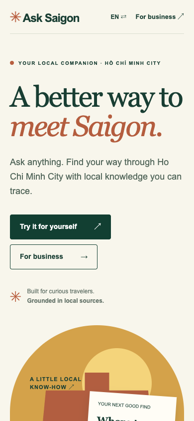
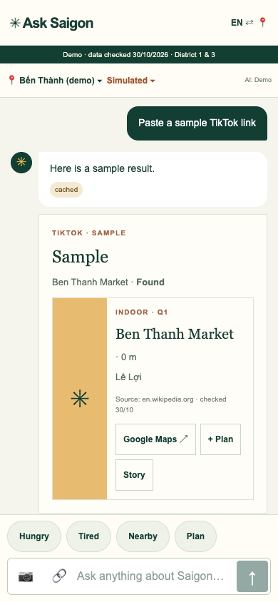
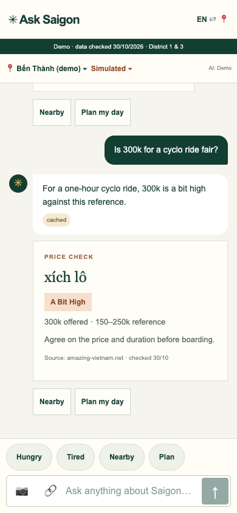
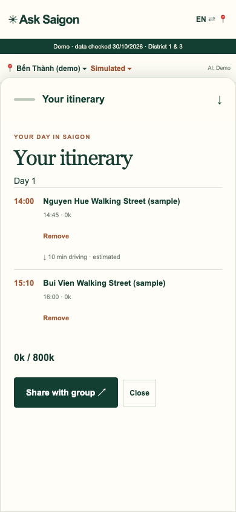
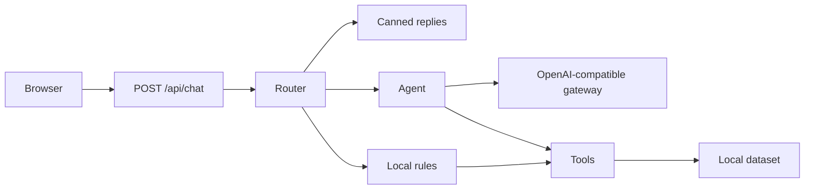

# Ask Saigon

**A travel chat that helps you discover Ho Chi Minh City with local context and traceable sources.**

[](https://github.com/KoangWy/ask-saigon/actions/workflows/ci.yml) [](LICENSE)

[Live demo](https://ask-saigon.vercel.app) · [Try the demo script](docs/demo-script.md) · [Architecture](docs/architecture.md)

| Start exploring | TikTok and a place | Price check | A day plan |
| --- | --- | --- | --- |
|  |  |  |  |

The current seed data is **provisional**, covers District 1 and District 3, and leaves unknown hours and prices blank. Sample TikTok and menu results and the sample itinerary are illustrative; check details before visiting.

## What you can ask

- **TikTok:** paste a supported TikTok link or choose a sample, then see a place match when one can be identified in the local dataset.
- **Menus:** choose one of two illustrated menus or upload an image for translation when an image-capable model is configured.
- **Prices:** compare a quoted price against a sourced reference, such as a cyclo ride.
- **Nearby:** find places around the selected location, including a default demo location at Bến Thành.
- **A day plan:** build an itinerary and try simulated rain, delays, budget alerts and group voting.

## How it works



The browser keeps the conversation and itinerary for the page session. The server validates requests and builds structured cards from tool results; the agent is instructed not to invent hours or prices. Free-form model text is not independently verified. Places and reference prices link to a source and checked date, while missing fields remain unknown. This is a demo, not a guarantee that a place or price has not changed; the [data guide](docs/data.md) explains provenance and updates.

## Quick start

Requires Node.js 22 and pnpm 12.6.0 (see `packageManager` in [`web/package.json`](web/package.json)). From the repository root:

```sh
cd web
corepack enable
pnpm i
cp .env.example .env.local
pnpm dev
```

Open `http://localhost:3000`. Without a key the app uses canned replies and rules. For a reproducible demo, open `http://localhost:3000/chat?offline=1&now=12:05`: `offline=1` selects canned/rule mode for the browser session, and `now` overrides the Vietnam time used in the demo. The API still runs on the local server; offline mode does not make the web app available without that server.

To enable the live agent, set `LLM_API_KEY` in `web/.env.local`. The key stays on the server; never add it to source control or expose it with a `NEXT_PUBLIC_` prefix.

## Scripts

Run these from `web/`:

| Command | Purpose |
| --- | --- |
| `pnpm dev` | Validate data and start the development server |
| `pnpm build-data` | Validate the CSVs and generate JSON |
| `pnpm lint` | Run ESLint |
| `pnpm typecheck` | Check TypeScript |
| `pnpm test` | Validate data and run unit tests |
| `pnpm build` | Validate data and build for production |
| `pnpm start` | Serve a production build |
| `pnpm test:e2e` | Run the offline iPhone 13 and Pixel 7 journeys |
| `pnpm smoke:live [base-url]` | Exercise the eight sample inputs against a running app and print timing and source |

For Playwright, install Chromium once with `pnpm exec playwright install chromium`. The optional recording project is run with `VIDEO_MODE=1 pnpm exec playwright test --project=video`; it records at human pace and is excluded from the default phone run. The live smoke test uses the default `http://localhost:3000` unless a base URL is supplied; it can call the configured provider and is not an offline test.

## Environment

These variables are in [`web/.env.example`](web/.env.example). They are server-side; the browser never needs a provider key.

| Variable | Default | Purpose |
| --- | --- | --- |
| `LLM_API_KEY` | empty | OpenCode Go API key; absent means local fallback |
| `LLM_BASE_URL` | `https://opencode.ai/zen/go/v1` | OpenAI-compatible gateway URL |
| `LLM_MODEL` | `deepseek-v4.1-flash` | Model sent to the gateway |
| `AI_MODE` | `on` | Set to `off` to disable AI requests |
| `AI_DAILY_CAP` | `300` | Per-process daily AI request cap |
| `AGENT_TIMEOUT_MS` | `25000` | Agent turn deadline in milliseconds |

## Project structure

```text
.
├── docs/                    Architecture, API, data and demo guides
├── .github/                 CI and contribution templates
└── web/
    ├── app/                 Pages and API routes
    ├── components/          Chat cards
    ├── data/                Source CSVs
    ├── lib/                 Schema, router, tools, rules and agent
    ├── public/samples/      Illustrated sample menus
    ├── scripts/             Data build and live smoke test
    └── tests/               Unit and phone e2e tests
```

## Deploy

Create a Vercel project with **Root Directory** set to `web/`, install with pnpm, and configure the server environment variables above. `pnpm build` validates and generates the local dataset before building. For a keyless demonstration set `AI_MODE=off`; test the deployed app and data before sharing it. The live demo URL above is a placeholder until deployment is confirmed.

## Roadmap

The `/business` page presents concepts, not running services: a B2B API and SDK, partner portal, demand analytics, clearly labelled sponsored suggestions, trip journal, bring-your-own-model support, and additional districts.

Built for the HIST 2026 project demonstration. Contributions are welcome under the [contribution guide](CONTRIBUTING.md); licensed under the [MIT License](LICENSE).
