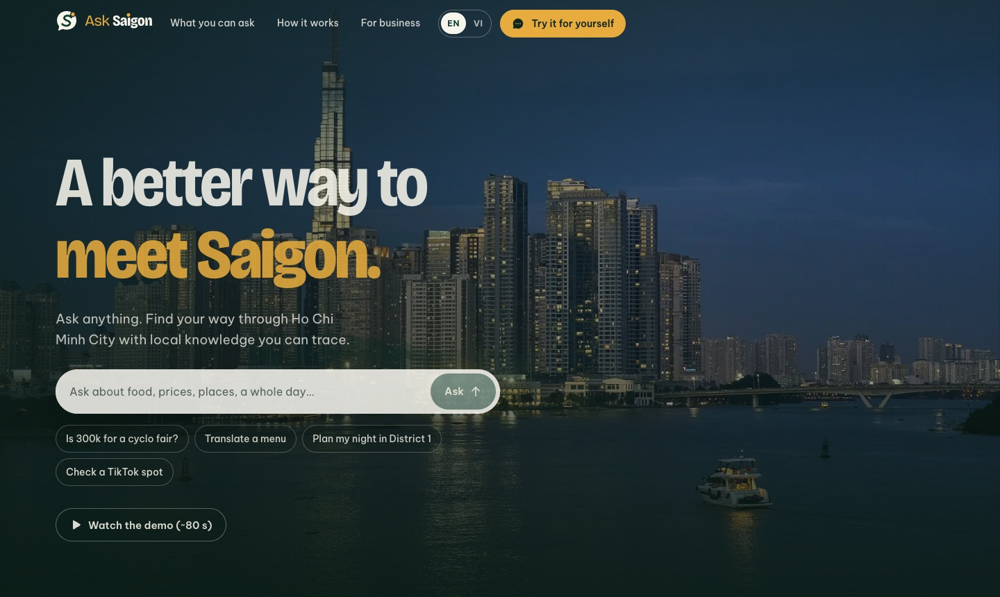
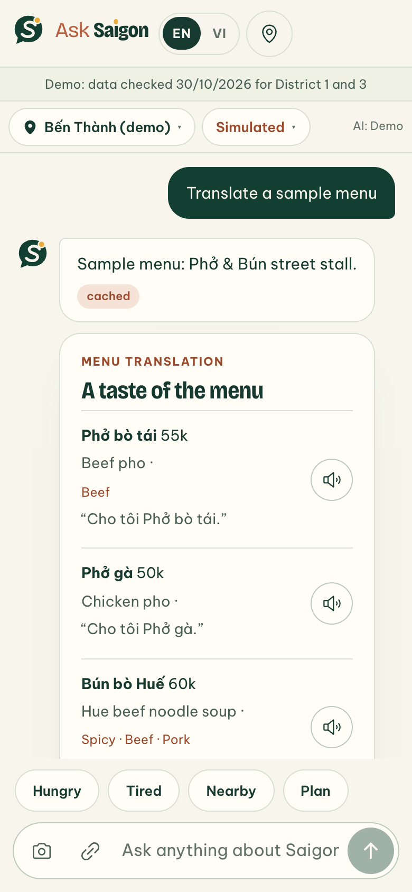
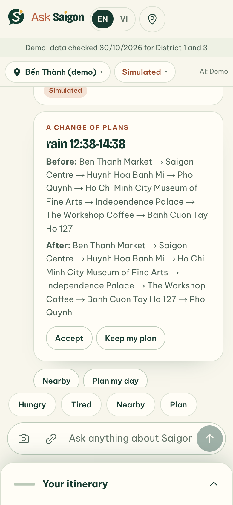
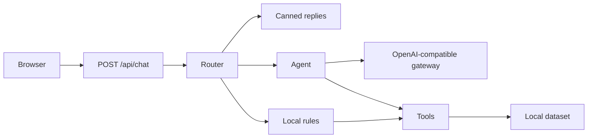

<p align="center">
  <a href="https://ask-saigon.vercel.app">
    <picture>
      <source media="(prefers-color-scheme: dark)" srcset="docs/images/logo-dark.png">
      
    </picture>
  </a>
</p>

<p align="center">
  <strong>The travel chat that knows Ho Chi Minh City.</strong><br>
  Paste a TikTok, translate a menu, check a price or plan a whole day.<br>
  Every answer comes back as a card that shows its source and the date it was checked.
</p>

<p align="center">
  <a href="https://github.com/KoangWy/ask-saigon/actions/workflows/ci.yml"></a>
  <a href="LICENSE"></a>
  <a href="https://ask-saigon.vercel.app"></a>
</p>

<p align="center">
  <a href="https://ask-saigon.vercel.app"><strong>Try it live</strong></a> ·
  <a href="https://ask-saigon.vercel.app/demo/ask-saigon-demo.mp4">Watch the demo (~80 s)</a> ·
  <a href="docs/demo-script.md">Demo script</a> ·
  <a href="docs/architecture.md">Architecture</a>
</p>

<a href="https://ask-saigon.vercel.app"></a>

<sub>Hero photo: “Saigon at Blue Hour” by Radek Kucharski, <a href="https://creativecommons.org/licenses/by/2.0">CC BY 2.0</a>, via <a href="https://commons.wikimedia.org/wiki/File:Saigon_at_Blue_Hour.jpg">Wikimedia Commons</a>.</sub>

## What you can ask

The home page opens on a question box, and every example drops you straight into the chat.

<table>
  <tr>
    <td align="center" width="25%"><br><sub><b>TikTok → place</b></sub></td>
    <td align="center" width="25%"><br><sub><b>Menu translation</b></sub></td>
    <td align="center" width="25%"><br><sub><b>Fair-price check</b></sub></td>
    <td align="center" width="25%"><br><sub><b>Day plan that adapts</b></sub></td>
  </tr>
</table>

<sub>Captured on an iPhone 13 viewport in offline demo mode (<code>/chat?offline=1&now=12:05</code>).</sub>

- **TikTok → place.** Paste a supported TikTok link or pick a sample, and get the place behind the video when it is in the local dataset, with hours, distance and a Google Maps link.
- **Menus.** Pick one of two illustrated sample menus, or upload a photo when an image-capable model is configured. Each dish comes with an English name, ingredient notes and a phrase to order it in Vietnamese.
- **Prices.** Ask whether a quote is fair, such as *“Is 300k for a cyclo ride fair?”*, and compare it with a sourced reference range.
- **Nearby and stories.** Find food, coffee and sights around you (or around the Bến Thành demo location) and read the story behind a place.
- **A day plan.** Build an itinerary in a sheet, then try simulated rain, running late, budget alerts and a group vote.

The interface is available in English and Vietnamese, follows your system's light or dark theme, and tones down its scroll motion when your device asks for reduced motion.

## Where answers come from



The browser keeps the conversation and itinerary for the page session. The server validates requests and builds structured cards from tool results; the agent is instructed not to invent hours or prices. Free-form model text is not independently verified. Places and reference prices link to a source and a checked date, and missing fields stay unknown rather than guessed. The [data guide](docs/data.md) explains provenance and updates.

The seed data is **provisional** and covers District 1 and District 3. Sample TikTok and menu results and the sample itinerary are illustrative, so check details before you visit.

## Quick start

Requires Node.js 22 and pnpm 12.6.0 (see `packageManager` in [`web/package.json`](web/package.json)). From the repository root:

```sh
cd web
corepack enable
pnpm i
cp .env.example .env.local
pnpm dev
```

Open `http://localhost:3000`. Without a key the app answers with canned replies and local rules. For a reproducible demo, open `http://localhost:3000/chat?offline=1&now=12:05`: `offline=1` selects canned/rule mode for the browser session, and `now` overrides the Vietnam time used in the demo. The API still runs on the local server; offline mode does not make the app work without it.

To enable the live agent, set `LLM_API_KEY` in `web/.env.local`. The key stays on the server: never commit it or expose it with a `NEXT_PUBLIC_` prefix.

## Scripts

Run these from `web/`:

| Command | Purpose |
| --- | --- |
| `pnpm dev` | Validate data and start the development server |
| `pnpm build-data` | Validate the CSVs and generate JSON |
| `pnpm lint` | Run ESLint |
| `pnpm typecheck` | Check TypeScript |
| `pnpm test` | Validate data and run unit tests |
| `pnpm build` | Validate data and build for production |
| `pnpm start` | Serve a production build |
| `pnpm test:e2e` | Run the offline iPhone 13 and Pixel 7 journeys |
| `pnpm smoke:live [base-url]` | Exercise the eight sample inputs against a running app and print timing and source |

For Playwright, install Chromium once with `pnpm exec playwright install chromium`. The optional recording project runs with `VIDEO_MODE=1 pnpm exec playwright test --project=video`; it records at human pace and is excluded from the default phone run. The live smoke test targets `http://localhost:3000` unless a base URL is given; it can call the configured provider and is not an offline test.

## Environment

These variables are in [`web/.env.example`](web/.env.example). They are server-side; the browser never needs a provider key.

| Variable | Default | Purpose |
| --- | --- | --- |
| `LLM_API_KEY` | empty | OpenCode Go API key; absent means local fallback |
| `LLM_BASE_URL` | `https://opencode.ai/zen/go/v1` | OpenAI-compatible gateway URL |
| `LLM_MODEL` | `deepseek-v4.1-flash` | Model sent to the gateway |
| `AI_MODE` | `on` | Set to `off` to disable AI requests |
| `AI_DAILY_CAP` | `300` | Per-process daily AI request cap |
| `AGENT_TIMEOUT_MS` | `25000` | Agent turn deadline in milliseconds |

## Project structure

```text
.
├── docs/                      Architecture, API, data and demo guides; README images
├── .github/                   CI and contribution templates
└── web/
    ├── app/                   Pages (home, chat, business, credits) and API routes
    ├── components/
    │   ├── brand/             Logo mark and wordmark
    │   ├── cards/             Chat cards
    │   ├── home/              Home page sections
    │   ├── motion/            Scroll reveals and page transitions
    │   └── site/              Header, footer and language toggle
    ├── data/                  Source CSVs and SOURCES.md
    ├── lib/                   Schema, router, tools, rules, agent and i18n
    ├── public/
    │   ├── demo/              Demo video
    │   ├── images/saigon/     City photos and their credit manifests
    │   └── samples/           Illustrated sample menus
    ├── scripts/               Data build, live smoke test, menu renderer
    └── tests/                 Unit and phone e2e tests
```

## Design

The mark is a speech bubble (*ask*) holding the S-bend of the Saigon River, with the sun rising out of its rim; the same sun dots the *i* in the wordmark. It lives in [`web/components/brand/Logo.tsx`](web/components/brand/Logo.tsx), with a standalone favicon in [`web/app/icon.svg`](web/app/icon.svg).

| Deep green | Cream | Rust | Gold |
| --- | --- | --- | --- |
| `#123f32` | `#f8f6ec` | `#b85f40` | `#e7ac3d` |

Headings use Bricolage Grotesque and body text uses Be Vietnam Pro, both loaded through `next/font` with Vietnamese subsets.

## Deploy

The live app runs on Vercel at [ask-saigon.vercel.app](https://ask-saigon.vercel.app). To deploy your own, create a Vercel project with **Root Directory** set to `web/`, install with pnpm, and set the server environment variables above. `pnpm build` validates and generates the local dataset before building. For a keyless deployment set `AI_MODE=off`.

## Roadmap

The `/business` page presents concepts, not running services: a B2B API and SDK, a partner portal, demand analytics, clearly labelled sponsored suggestions, a trip journal, bring-your-own-model support and more districts.

## Credits and license

The code is released under the [MIT License](LICENSE). City photos come from Wikimedia Commons and keep their own licenses (CC0, CC BY 2.0 and CC BY-SA 2.0/3.0/4.0); authors and links are listed on the [credits page](https://ask-saigon.vercel.app/credits) and in [`web/public/images/saigon/`](web/public/images/saigon). Place and price sources are listed in [`web/data/SOURCES.md`](web/data/SOURCES.md).

Built for HIST 2026. Contributions are welcome; see the [contribution guide](CONTRIBUTING.md).
